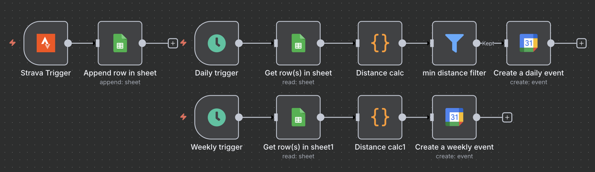

I installed <a href="https://n8n.io" target="_blank">n8n</a> on my server, deployed it, and created my first workflow in a couple of hours. I believe you could do it in even 15 minutes :) 

### The problem
I run almost every day and my coach wants me to add the covered distance to the shared Google Calendar. We have an event each day at 10 pm and a weekly event with the weekly mileage. 

### The idea 
Well, I thought since I have the distance on Strava (and Strava is so nice to offer a public API), I would just pull the distance from the Strava API and push this number into Google Calendar. 

I was thinking of writing a Python script and hosting it somewhere in the cloud, BUT while I was explaining the problem to my good friend Tilman, he said that n8n would be interesting in this case and achieve the same result with less effort and costs.

I was a bit skeptical because I had heard of n8n being an “hyped” no-code automation tool. However, since I trust Tilman when it comes to engineering solutions, I tried it out and... wow! 

What follows is a simple yet complete guide to get n8n running on your machine to show how easy it is to create the infrastructure for your automations.

## How to get n8n running in the easiest way possible? 
### Prerequisites:
- Docker Engine & Docker compose
- <a href="https://caddyserver.com/docs/install" target="_blank">Caddy</a> (a web server and reverse proxy)
- A machine connected to the internet that acts as a server (for reference, I’m using an Ubuntu instance on Hetzner)
- A (sub)domain that points to your server 

### Setup 

Note: I am hosting different applications and domains on the same server, therefore I prefer to have only one Caddy (my proxy server) instance outside Docker.

1. Add the subdomain/domain to the Caddy config file. 
```
nano /etc/caddy/Caddyfile
```
```
yoursubdomain.yourdomain.net {
    reverse_proxy localhost:5678
}
```

2. Create a docker-compose file for n8n. You can put it wherever you like on your server. I like to have it in the /opt folder.
```
mkdir /opt/n8n
cd /opt/n8n
nano docker-compose.yml 
 ```
 ```
services:
  n8n:
    image: docker.io/n8nio/n8n:latest
    restart: always
    ports:
      - "5678:5678"
    environment:
      WEBHOOK_URL: "https://yoursubdomain.yourdomain.net/"
      GENERIC_TIMEZONE: "Europe/Vienna"
      N8N_PROXY_HOPS: "1"
    volumes:
      - n8n_data:/home/node/.n8n

volumes:
  n8n_data:
```

```
docker compose up -d
```
You can also configure it to have the environment variables in a .env file! 


This is all you need! Go to your subdomain and you can use n8n immediately. At the first visit, you are asked to create an account. 


## My first workflow
I will not go into detail since the automation is useless for 99% of people.
First however, here is the workflow as image:
<br />

<br />
Second however, some key takeways are: 
- Major troubleshooting was figuring out why the webhook URL pointed to localhost instead of my domain. The solution was adding the parameter WEBHOOK_URL in the docker-compose.
- I spent the most time creating and enabling access for the API services on Google & Strava. I found the n8n docs to be very generic in this aspect. 
- I tried to minimize the “communication” cost between external (API requests outside the server) and internal nodes, but I was not successful in most cases. For example, instead of fetching all rows from my Google Sheet and then filtering in a separate internal node, I tried to filter first and pass only the filtered rows to the next node but this was somehow not possible. I think this is okay and a compromise people are willing to make for having a drag-and-drop tool, but needs to be considered when moving large data. 
- I tried to avoid python/js code completely, but I found that having a code node simplified the workflow. Instead of multiple nodes, I could tie the logic to a single code node. In terms of computational costs, I’m not sure if this is a gain at all, since the workflow steps are sequential anyway.
- There are a lot of “connectors” (aka pre-configurations) for third-party tools where you only need to add your client ID and secret and then select the API method. Luckily, I could find connectors for Google Calendar and Strava.
- Overall it took me only a few hours of work to install, configure, and create my first automated workflow.
- I would like to use n8n for future automations, since it can be self-hosted and free! But for now, I don’t have any use cases (:


