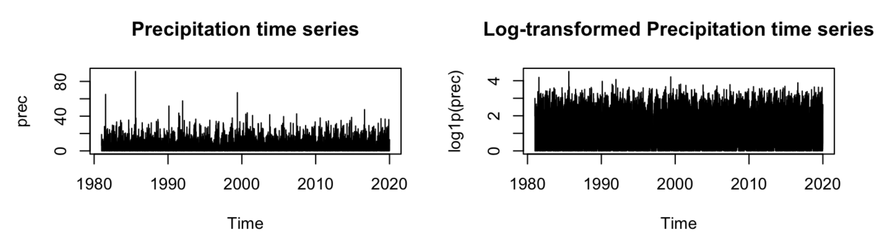
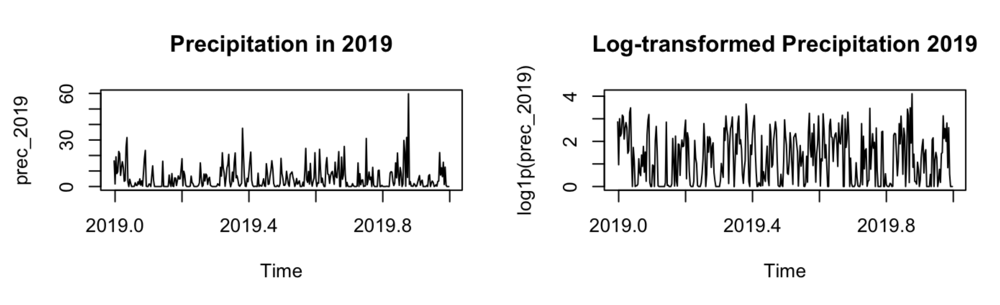
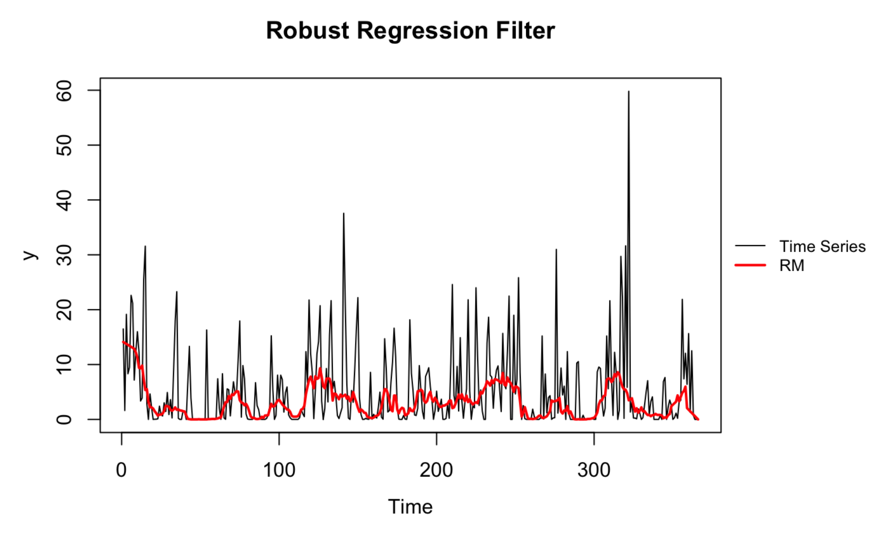
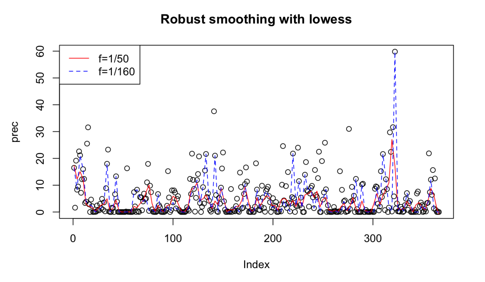
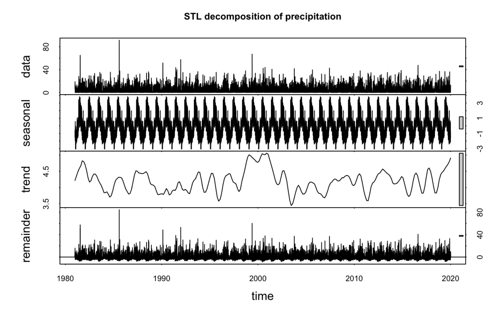
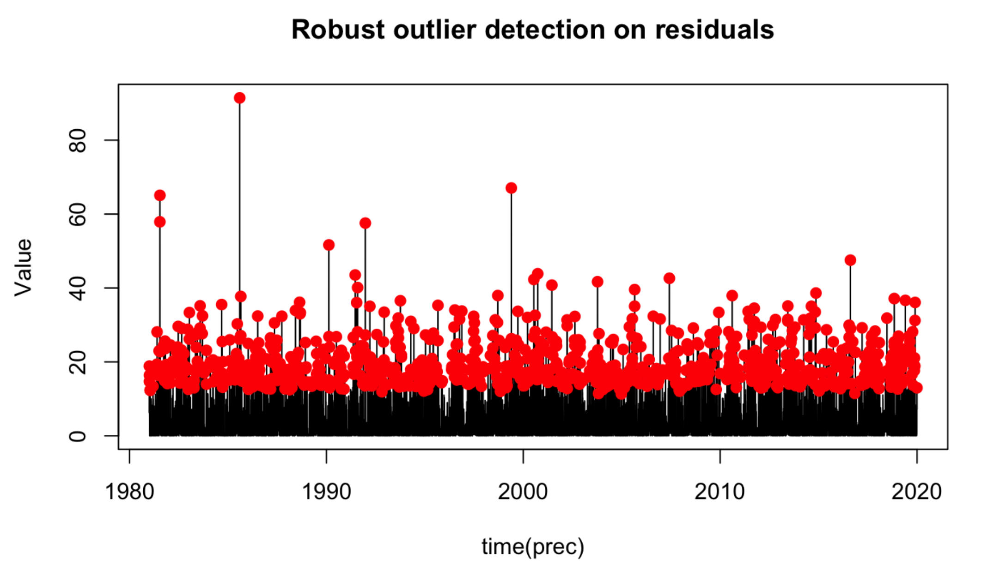
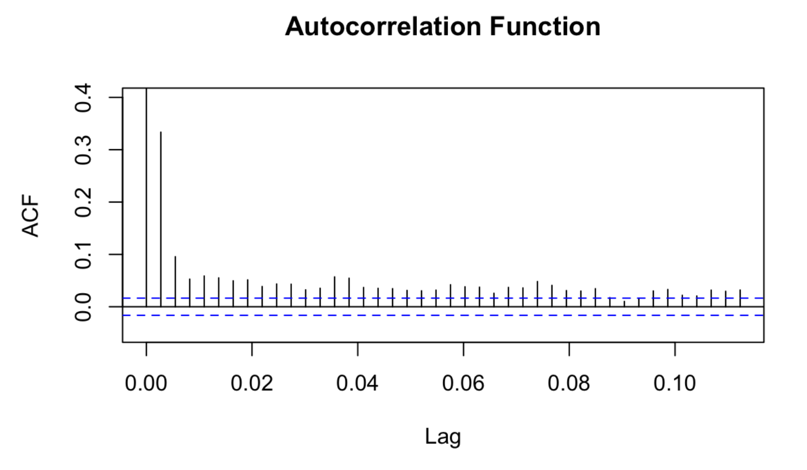
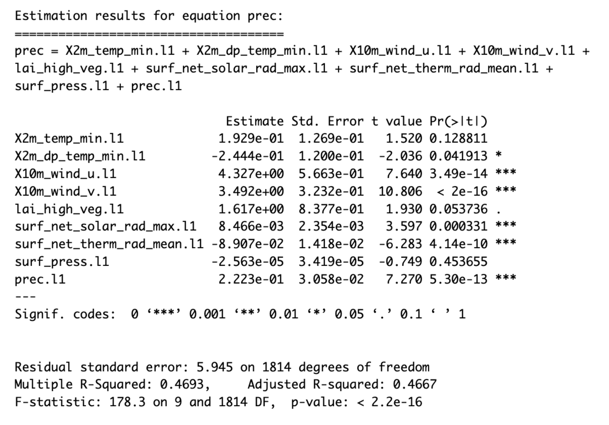

In this post I want to show a way to approach the analysis of timeseries + how to apply forecasting models in R. 
There are many ways to perform a statistical analysis and many forecasting models one can try as well.

> The purpose is not to achieve the best result, but rather explain some methods and provide the code snippets for them in R in order to be able to replicate the steps. 

---

## The given task 
The tasks included performing time series analysis with appropriate preprocessing steps (such as handling missing values and ensuring data quality) and then developing forecasting models capable of predicting the next day’s precipitation. Precise precipitation forecasts are important for applications in agriculture, water resource management, urban planning, and disaster preparedness.
The dataset is LamaH, a large-scale hydrological and meteorological collection. In this analysis and forecasting, we will only use the **daily** metheorological time series for over 859 locations and a span of 35 years. 

### The timeseries 
We are given a daily meteorological time series for 859 (unknown) locations. Each entry point is described by **20 features**. Our target variable is the daily precipitation (prec), while other variables include, for example, air temperature (2m_temp), dew point (2m_dp_temp), wind speed (10m_wind_u, 10m_wind_v), snow water equivalent (swe), and net solar radiation (surf_net_solar_rad). 

In R we create a timeseries object with the following:
```
prec <- ts(data$prec, start = c(data2$YYYY[1], data2$DOY[1]),  end = c(max(data2$YYYY), max(data2$DOY)), frequency = 365)
```

---

## Data analysis
We start with the analyis by randomly selected 100 locations from the LamaH dataset. A quick check shows no missing values in the timeseries, so no data imputation necessary. This is a good sign for data trust. 

First, we apply (robust) univariate methods applied to precipitation and then extend the analysis to multivariate modeling.

### Univariate robust analysis
We analyse here only our target variable "daily precipitation", therefore "univariate". We plot the variable across the full observation period (1981–2019) (see Figure 1) and for a single year (2019) (see Figure 2), and its log transformations (we use the log1p function since we have many zero values). 

```{r}
par(mfrow=c(2,2))
plot.ts(prec_2019, main="Precipitation in 2019")
plot.ts(log1p(prec_2019), main="Log-transformed Precipitation 2019")
plot.ts(prec, main="Precipitation time series")
plot.ts(log1p(prec), main="Log-transformed Precipitation time series")
```


<p class="figure-caption">Figure 1: Precipitation time series showing the full observation period (1981-2019) and log-transformed precipitation. The left panel shows the raw precipitation data with high variability and extreme values, while the right panel shows the log-transformed data which helps stabilize the variance.</p>


<p class="figure-caption">Figure 2: Precipitation time series for the year 2019 showing daily precipitation patterns and its log transformation. This single-year view reveals the day-to-day variability that characterizes precipitation data.</p>

At first glance, the series does not follow a simple moving-average process, and neither clear trends nor seasonality are immediately visible. 

To gain further insight, we explored different robust smoothing approaches. 
We apply a robust regression filter using the *robfilter* package in R. This robust regression filter can be used to remove outliers while preserving the underlying signal structure (see Figure 3). The underlying assumption is local linearity within a window of specified length (an odd number). The parameters $\mu$ (intercept) and $\beta$ (slope) of this "local" linear function are estimated robustly. The implementation in the *robfilter* package achieves this by using the repeated median estimator.

The code is simple as that. The second parameter with value 15 specifies the window length. 
```{r}
library(robfilter)
res <- rm.filter(data$prec,15)
plot(res)
```


<p class="figure-caption">Figure 3: Robust regression filter applied to the precipitation time series. The black line shows the original time series while the red line shows the robust moving average (RM), effectively filtering out extreme values while maintaining the underlying trend.</p>


In Figure 4 we show the Loess smoothing with different window lengths. In Loess the regression model can be either lineaer or quadratic, and the parameters of the function are estimated by a weighted RSS (residuals sum of squares). While Loess is not typically applied in timeseries since it does not assume equidistant points but rather pairs of x, y values where we want to obtain smoothed y values, we show the simple implementation in R. A variation of the Loess smoothing is then applied for the STL decomposition, which instead is very useful in a timeseries context. 

```{r}
plot(data$prec, main="Robust smoothing with lowess", ylab = "prec")
lines(lowess(data$prec,f=1/50), col = "red")
lines(lowess(data$prec,f=1/160), col = "blue", lty=2)
legend("topleft", legend = c("f=1/50", "f=1/160"), col = c("red", "blue"), lty = c(1, 2))
```


<p class="figure-caption">Figure 4: Robust smoothing with Loess using different smoothing parameters (f=1/50 and f=1/160). The different smoothing parameters show how the choice of bandwidth affects the resulting smooth curve, with smaller f values providing more local smoothing.</p>

Both methods successfully reduce the influence of potential outliers, which is often desirable in time series analysis. However, for our forecasting task we explicitly avoid smoothing since these approaches are trying to "average out" the short-term variation and therefore hide the actual day-to-day fluctuations which we are interested to and finally want to forecast.

The log-transformated time-series can instead be taken to have better estimations in regression models. Instead of absolute deviations in the precipation, we will look at the relative difference. 

### Seasonal-trend decomposition using Loess
Given the metheorological domain, we expect some type of seasonalality or trends over time. 

To systematically investigate seasonality and potential trends, we applied STL decomposition (Seasonal-Trend decomposition using Loess). This separates the time series into three components: trend, seasonality, and remainders. The decomposition confirms the presence of annual seasonality, but no clear long-term trend is visible. The extracted remainders (residuals) are particularly valuable for outlier detection and forecasting.

```{r}
fit <- stl(prec,s.window="periodic")
plot(fit, main="STL decomposition of precipitation")
```


<p class="figure-caption">Figure 5: STL decomposition of the precipitation time series showing the original data, seasonal component, trend component, and remainder (residuals). The seasonal component clearly shows annual patterns, while the trend component reveals no significant long-term changes. The remainder component is used for robust outlier detection.</p>

### Robust outlier detection
A naive way to identify outliers would be to look at the overall distribution and define cutoffs using robust estimators of location and scale. Yet, this is insufficient in a time series context: during high-rainfall periods, large values might look like outliers globally, but they are in fact consistent within their local seasonal and trend context.
By focusing on the residuals from the STL decomposition, we avoid this pitfall and identify only those points that deviate unexpectedly after accounting for seasonal and trend patterns. The resulting analysis (Figure 6) flagged only two days as true outliers. Interestingly, very high precipitation events were not marked as outliers, since they align with seasonal expectations.

```{r}
library(forecast)
remainders <- remainder(fit)
outlier_stats <- boxplot.stats(remainders)

outliers <- which(remainders < outlier_stats$stats[1] | remainders > outlier_stats$stats[5])

plot(time(prec), prec, type = "l", ylab = "Value", main = "Robust outlier detection on residuals")
points(time(prec)[outliers], prec[outliers], col = "red", pch = 19)
```


<p class="figure-caption">Figure 6: Robust outlier detection applied to the residuals from STL decomposition. Red points indicate detected outliers, while black points represent normal observations.</p>

The analysis reveals that the time series contains numerous outliers by definition. The question arises: should we eliminate, remove, or scale these outliers? This decision is not straightforward, as we are dealing with a regression problem aiming to predict the exact quantity in mms of water drops. Heavy rainfall on a particular day, though considered an outlier, might not be irrelevant as it can contribute valuable information for predicting the next day. We also assume that such models are used to avoid or predict natural disasters. That’s why we believe that these outliers play a very important role and are even crucial, because we want to predict them correctly.
Consequently, while we successfully identify outliers robustly, we choose not to address them due to the mentioned reasons.

---

## Univariate forecasting
Now we predict the next day precipation by using only the precipitation history.

As dummy baselines we will use: 
* Zero-precipitation
* Mean-precipitation
* Previous day precipitation

### (Partial) auto correlation
Another important aspect for modeling time series is the dependence of a time stamp on previous time stamps. We want to find out the degree of the so-called lag. For this purpose we can calculate the autocovariance and analyze the results using an autocorrelation function and partial autocorrelation function. The ACF shows us strong correlation for lag of size 2. Some after lag 15, the correlation decreases towards 0. This is typically the case for autoregressive models.

```{r}
auto <- acf(prec)
plot(auto, ylim = c(-0.05, 0.4), main = "Autocorrelation Function")
pato <- pacf(prec)
```


<p class="figure-caption">Figure 7: Autocorrelation function (ACF) of the precipitation time series. The plot shows significant correlation at small lags, with values gradually decreasing towards zero. The blue dashed lines represent the 95% confidence intervals for testing significance of correlations.</p>

### Exponential smoothing
Exponential smoothing serves as a straightforward baseline. The underlying assumption is that the future will resemble the recent past. To achieve this, we apply exponentially decreasing weights towards the lag order. We employ a rolling window forecasting approach on the ”prec” time series. Unfortunately, the results are unsatisfactory, yielding a worse RMSE than all other baselines.


### Auto-regressive model
Similar to exponential smoothing, we implement rolling forecasting using an ARIMA model of order (1,0,0) to predict the next day’s precipitation. This model is effectively equivalent to a simple autore- gressive (AR) model of order 1, recommended by the ’auto.arima’ function in the ’forecast’ package in R. Varying orders produce either worse or similar results. Nevertheless, the outcomes are promising, as we surpass two out of the three baselines and significantly outperform the exponential smoothing method. The results are summarized in Table 1.


```{r}
# exp smoothing + AR (uncomment)
# Start of the test set
#9863 -> 01.01.2008
#14245 -> 31.12.2019
#test_start <- 9964
#test_length <- 3870

rolling_forecast <- function(df, test_length = 4370, test_start = c(2008, 1)) {
  
  # Initialize vectors to store predicted and actual values
  forecast_values <- numeric(test_length)
  actual_values <- numeric(test_length)
  
  # Perform rolling forecast for each day in the test set
  for (i in 1:test_length) {
    # Calculate the index to split the data into training and testing sets

    # Create a training set using time series indexes
    train_data <- window(prec, start = c(1981, 1 + i), end = c(2007, 365 + i))    
    
    #hw_model <- HoltWinters(train_data, alpha = 0.5, beta = FALSE, gamma = FALSE)
    arima_model <- arima(train_data, order = c(1, 0, 0))
  
    forecast_values[i] <- forecast(arima_model, h = 1)$mean
    #forecast_values[i] <- forecast(hw_model, h = 1)$mean
    
    # Extract the actual value for the next day
    actual_values[i] <- as.numeric(window(df$prec, start = c(2008, i), end = c(2008, i)))
  }
  
  # Calculate MAE and RMSE for all predictions
  mae <- mean(abs(forecast_values - actual_values))
  rmse <- sqrt(mean((forecast_values - actual_values)^2))
  
  return(list(mae = mae, rmse = rmse))
}
```

---


## Multivariate forecasting
We are presented with 20 variables, where only some of them may contain patterns relevant for our prediction. We have already seen that an univariate scenario is working quite well. The question now is if we can improve the accuracy of our forecast by adding new features to the model. 

As first step we calculated cross-correlations in order to address multicollinearity, and increase the generalization of the model. Having less features will help us analyze, plot and explain the correlations and the model properties better. 


```{r}
library(vars)

perform_var_forecasting <- function(df) {
  test_length <- 4370
  upper_bound <- max(df[, 9]) * 1.5
  lower_bound <- 0
  
  all_forecast_values <- numeric(test_length)
  all_actual_values <- as.numeric(window(df[, 9], start = c(2008, 1), end = c(2008, test_length)))
  mae_values <- numeric(test_length)
  rmse_values <- numeric(test_length)
  
  for (i in 1:test_length) {
    train_data <- window(df, start = c(2000, 1 + i), end = c(2007, 365 - 1 + i))
    var_model <- VAR(train_data, ic = "AIC", type = "none")
    
    all_forecast_values[i] <- predict(var_model, n.ahead = 1)$fcst[[9]][, 1]
    all_forecast_values <- pmax(pmin(all_forecast_values, upper_bound), lower_bound)
    
    mae_values[i] <- abs(all_forecast_values[i] - all_actual_values[i])
    rmse_values[i] <- (all_forecast_values[i] - all_actual_values[i])^2
  }
  
  mae <- mean(mae_values)
  rmse <- sqrt(mean(rmse_values))
  
  return(list(mae = mae, rmse = rmse))
}
```

As a result, we obtain nine features, including ”prec”, which are used in a Vector auto-regressive (VAR) model. Our goal remains the same, that is forecasting next day precipitation. In the VAR model, the chosen information criterion is AIC, and due to the nature of the precipitation data, no deterministic regressors are included.
As anticipated, the inclusion of other variables has proven beneficial to the accuracy of our predictions. The mean RMSE decreases across all 100 locations, representing our best result so far.
The function VAR from the package "vars" in R also provides a useful summary of the model. Shown in Figure 8 is the summary of our VAR model for forecasting "prec" using lags of order 1. The summary can be used to extract features which have a significant influence on the model.


<p class="figure-caption">Figure 8: Vector Autoregressive (VAR) model estimation results for precipitation forecasting. The table shows coefficient estimates, standard errors, t-values, and p-values for each predictor variable. Variables with significant coefficients (marked with asterisks) have the strongest influence on next-day precipitation predictions.</p>

## Results and next steps
The results show that including additional features to the precipitation forecast improves the overall performance defined by the MAE and RMSE metrics. 

Considering only a univariate context, the auto-regressive model outperforms two of our three baselines.

As next steps, I suggest to deploy machine & deep learning models. My project colleague was responsible for this part and achieved good results using all attributes in the models. The best performing model in the end was a random forest regressor (these trees are always good...). 


